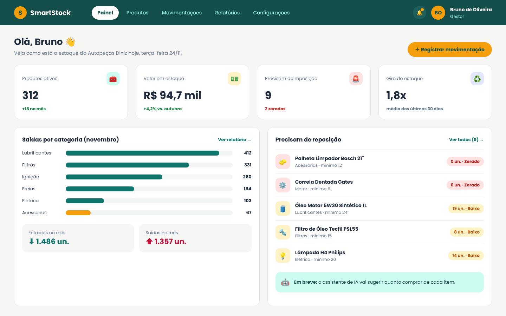
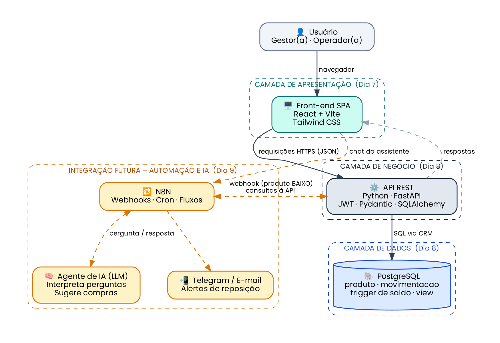
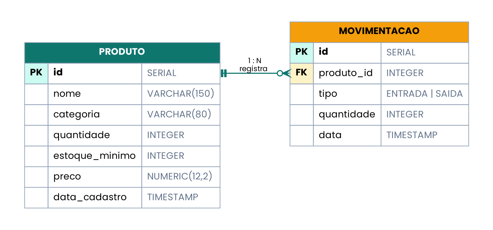
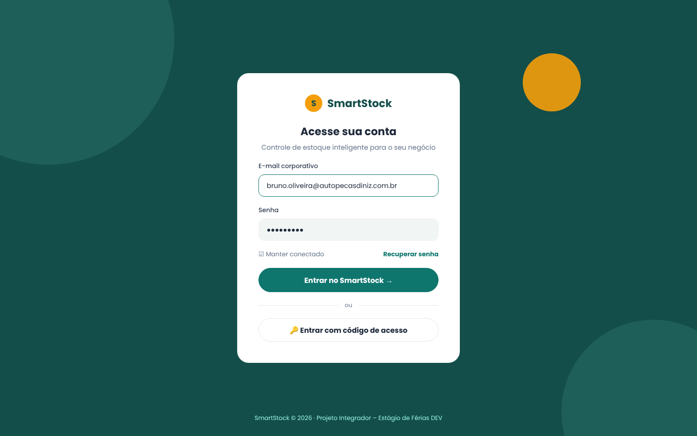
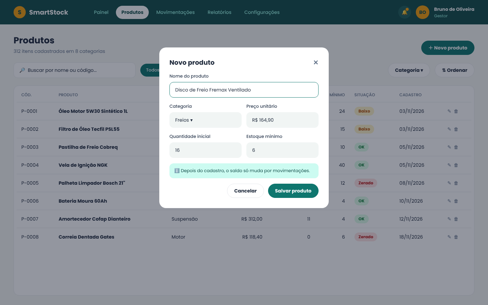
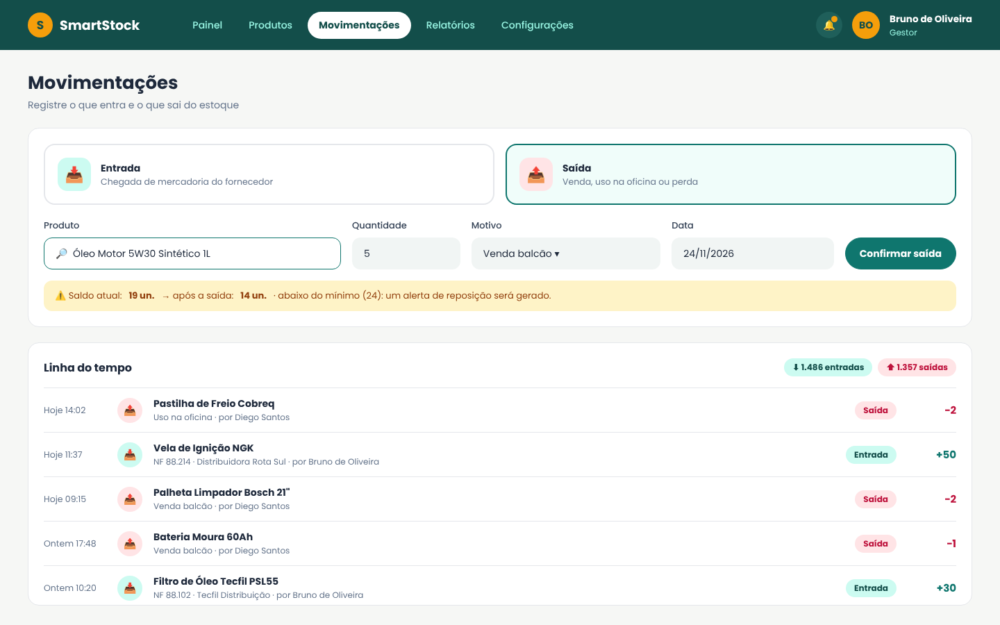
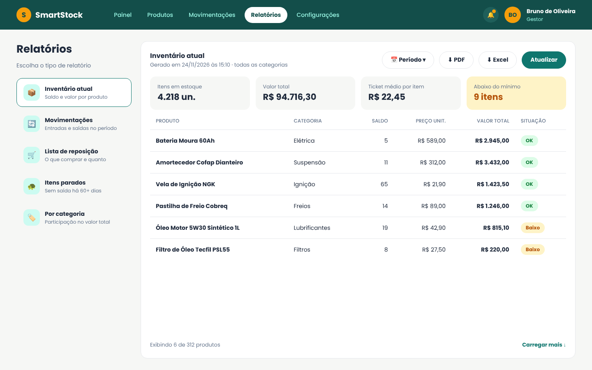
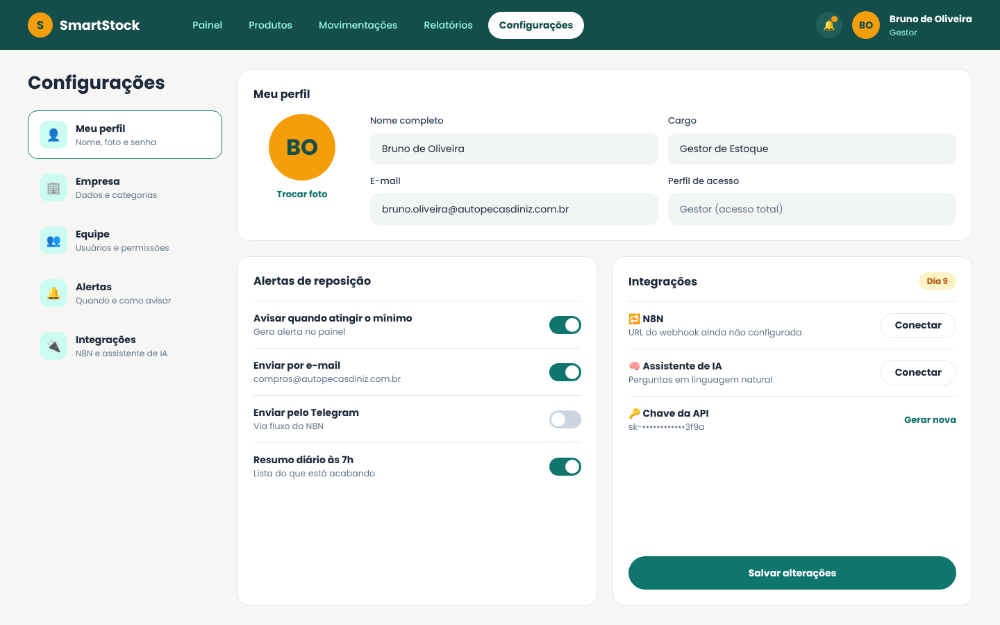

<h1 align="center">SmartStock</h1>
<p align="center"><b>Plataforma Inteligente de Gestão de Estoque</b><br>
Projeto Integrador · Programa de Estágio de Férias – Desenvolvimento de Software<br>
Atividade 6 – Planejamento, Design e Arquitetura da Solução</p>
<p align="center">Desenvolvido por <b>Bruno de Oliveira</b> (<a href="https://github.com/brunooliveira170509">@brunooliveira170509</a>)</p>

---



## Sobre o projeto

O **SmartStock** ajuda pequenas empresas a controlar o estoque sem planilhas: cadastro de produtos, entradas e saídas, alertas de estoque mínimo, painel de indicadores e relatórios. A plataforma está sendo construída em quatro dias:

| Dia | Entrega | Status |
|:---:|---|:---:|
| 6 | Requisitos, banco de dados, arquitetura e protótipo | ✅ |
| 7 | Front-end (React) | 🔜 |
| 8 | Back-end (FastAPI) e banco (PostgreSQL) | 🔜 |
| 9 | Automação com N8N e assistente de IA | 🔜 |

## Entregáveis do Dia 6

- 📄 **Documento de requisitos:** [documentacao/1-documento-de-requisitos.md](documentacao/1-documento-de-requisitos.md)
- 🗄️ **Modelo do banco de dados:** [documentacao/2-modelagem-banco-de-dados.md](documentacao/2-modelagem-banco-de-dados.md) · script [banco/smartstock_postgres.sql](banco/smartstock_postgres.sql)
- 🏗️ **Fluxograma da arquitetura:** [documentacao/3-arquitetura-da-solucao.md](documentacao/3-arquitetura-da-solucao.md)
- 🎨 **Protótipo no Figma:** https://www.figma.com/design/2wjN6TUPeYMqab2NvezFPj · detalhes em [documentacao/4-prototipo-figma.md](documentacao/4-prototipo-figma.md)
- 🖼️ **Capturas de tela:** [design/telas](design/telas)

## Arquitetura



## Banco de dados



## Telas do protótipo

| | |
|:---:|:---:|
| <br>Login | <br>Produtos |
| <br>Movimentações | <br>Relatórios |
| <br>Configurações | <br>Painel |

## Stack planejada

| Camada | Tecnologia |
|---|---|
| Front-end | React · Vite · Tailwind CSS |
| Back-end | Python · FastAPI · SQLAlchemy · JWT |
| Banco | PostgreSQL |
| Automação | N8N |
| IA | Agente com LLM via N8N |
| Design | Figma |

## Estrutura

```
├── documentacao/   requisitos, banco, arquitetura e protótipo
├── banco/          script SQL (PostgreSQL)
├── diagramas/      DER e arquitetura (.dot, .png, .svg)
└── design/         protótipo HTML e capturas das telas
```
