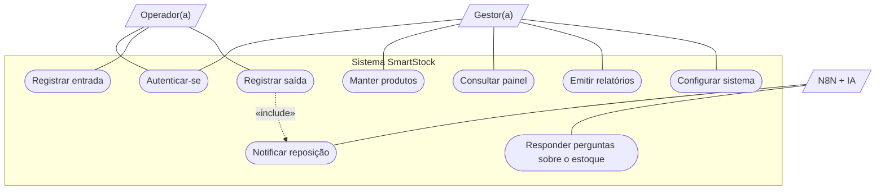

# Documento de Requisitos – SmartStock

| Item | Informação |
|---|---|
| Sistema | SmartStock – Plataforma Inteligente de Gestão de Estoque |
| Contexto | Projeto Integrador · Estágio de Férias DEV · Atividade 6 |
| Responsável | Bruno de Oliveira |
| Data | 24/11/2026 |
| Versão | 1.0 |

---

## 1. Objetivo do sistema

O SmartStock tem como objetivo oferecer às empresas uma forma simples e confiável de saber **o que têm, quanto têm e quando precisam comprar**. A plataforma reúne em um único ambiente web o cadastro de produtos, o registro das entradas e saídas, a consulta de saldos, os indicadores do estoque e os relatórios gerenciais. Em uma etapa futura, um agente de Inteligência Artificial, orquestrado pelo N8N, vai responder perguntas sobre o estoque e automatizar avisos de reposição.

## 2. Problema que será resolvido

Em muitas pequenas empresas, o controle de estoque depende de anotações em papel, planilhas compartilhadas por e-mail ou da memória de quem trabalha no depósito. Isso causa:

1. **Saldo que não bate com a prateleira**: ninguém sabe ao certo quantas unidades existem de cada item.
2. **Ruptura de estoque**: o produto acaba e só se percebe quando o cliente pede.
3. **Compras em excesso**: por insegurança, compra-se mais do que o necessário, prendendo capital parado.
4. **Retrabalho para gerar números**: montar um relatório mensal leva horas.
5. **Falta de rastreabilidade**: não há registro de quem tirou ou colocou mercadoria e quando.

> **Cenário exemplo:** uma papelaria de bairro descobre que acabou o papel A4 numa segunda-feira de volta às aulas, porque a última resma foi vendida no sábado e ninguém anotou.

## 3. Público-alvo

Micro e pequenas empresas com estoque físico: **papelarias, lojas de material de construção, autopeças, mercadinhos, distribuidoras e pequenos e-commerces**.

### Personas

| Persona | Quem é | O que precisa |
|---|---|---|
| 👩‍💼 **Camila – Proprietária** | Dona de uma loja de autopeças, 42 anos, pouco tempo livre | Ver rapidamente se o negócio está saudável e quanto dinheiro está parado no estoque |
| 👷 **Diego – Estoquista** | Responsável pelo depósito, usa o celular no dia a dia | Registrar entradas e saídas em poucos toques, sem erro |
| 📊 **Renata – Compradora** | Cuida das compras com fornecedores | Saber o que está acabando e quanto comprar |

## 4. Funcionalidades do sistema

### 4.1 Histórias de usuário

| ID | Como… | Eu quero… | Para… |
|---|---|---|---|
| HU01 | usuário | entrar com e-mail e senha | acessar somente os dados da minha empresa |
| HU02 | proprietária | cadastrar um produto com preço e estoque mínimo | começar a controlá-lo |
| HU03 | estoquista | procurar um produto pelo nome ou pela categoria | encontrar rápido o que preciso |
| HU04 | proprietária | editar ou remover um produto | manter o catálogo atualizado |
| HU05 | estoquista | registrar a chegada de mercadoria | aumentar o saldo automaticamente |
| HU06 | estoquista | registrar a retirada de mercadoria | diminuir o saldo automaticamente |
| HU07 | compradora | ser avisada quando um item chegar ao mínimo | comprar antes de faltar |
| HU08 | proprietária | ver um painel com os principais números | acompanhar o negócio em segundos |
| HU09 | proprietária | gerar e exportar relatórios | analisar e prestar contas |
| HU10 | compradora | perguntar à IA "o que preciso comprar esta semana?" | decidir mais rápido (futuro) |

### 4.2 Requisitos funcionais

| Código | Descrição | Origem | Prioridade |
|---|---|---|---|
| REQ-F01 | O sistema deve autenticar usuários por e-mail e senha | HU01 | Essencial |
| REQ-F02 | O sistema deve permitir **cadastrar** produtos (nome, categoria, quantidade inicial, estoque mínimo, preço) | HU02 | Essencial |
| REQ-F03 | O sistema deve permitir **consultar** produtos por nome, categoria e situação do estoque | HU03 | Essencial |
| REQ-F04 | O sistema deve permitir **atualizar** os dados cadastrais de um produto | HU04 | Essencial |
| REQ-F05 | O sistema deve permitir **excluir** produtos sem movimentações | HU04 | Essencial |
| REQ-F06 | O sistema deve registrar **entradas** de estoque | HU05 | Essencial |
| REQ-F07 | O sistema deve registrar **saídas** de estoque, impedindo saldo negativo | HU06 | Essencial |
| REQ-F08 | O sistema deve manter o histórico de todas as movimentações | HU05, HU06 | Essencial |
| REQ-F09 | O sistema deve classificar cada produto como *OK*, *Baixo* ou *Zerado* | HU07 | Essencial |
| REQ-F10 | O sistema deve gerar alertas de reposição ao atingir o estoque mínimo | HU07 | Importante |
| REQ-F11 | O sistema deve exibir um dashboard com indicadores (itens, valor total, itens em alerta, giro) | HU08 | Importante |
| REQ-F12 | O sistema deve gerar relatórios de inventário, movimentações e reposição | HU09 | Importante |
| REQ-F13 | O sistema deve exportar relatórios em PDF e Excel | HU09 | Desejável |
| REQ-F14 | O sistema deve permitir configurar perfil, empresa, usuários e notificações | — | Desejável |
| REQ-F15 | O sistema deve expor webhooks para o N8N | HU10 | Futuro (Dia 9) |
| REQ-F16 | O sistema deve oferecer um assistente de IA em linguagem natural | HU10 | Futuro (Dia 9) |

### 4.3 Requisitos não funcionais

| Código | Categoria | Descrição |
|---|---|---|
| REQ-NF01 | Usabilidade | Interface responsiva, utilizável em celular pelo estoquista |
| REQ-NF02 | Usabilidade | Qualquer movimentação deve ser registrada em no máximo 3 cliques |
| REQ-NF03 | Desempenho | Páginas devem carregar em menos de 2 s com até 5.000 produtos |
| REQ-NF04 | Segurança | Senhas com hash Argon2/bcrypt e autenticação por token JWT |
| REQ-NF05 | Segurança | Controle de acesso por perfil (Gestor e Operador) |
| REQ-NF06 | Confiabilidade | Saldo atualizado automaticamente pelo banco (trigger), sem edição manual |
| REQ-NF07 | Tecnologia | Front-end em React, API em Python (FastAPI) e banco PostgreSQL |
| REQ-NF08 | Manutenibilidade | Código versionado no GitHub, com README e documentação |
| REQ-NF09 | Interoperabilidade | API REST com documentação automática (Swagger/OpenAPI) |
| REQ-NF10 | Disponibilidade | Funcionamento nos navegadores Chrome, Edge e Firefox atuais |

### 4.4 Regras de negócio

- **RN-01:** a quantidade em estoque nunca pode ser negativa.
- **RN-02:** o saldo só muda por meio de movimentações; o campo quantidade não é editável manualmente após o cadastro.
- **RN-03:** situação do produto: **Zerado** se quantidade = 0; **Baixo** se quantidade ≤ estoque mínimo; **OK** nos demais casos.
- **RN-04:** produtos com histórico de movimentações não podem ser excluídos.
- **RN-05:** toda movimentação precisa ter quantidade maior que zero.

### 4.5 Casos de uso

**Descrição – Registrar saída (C4)**

| Campo | Conteúdo |
|---|---|
| Ator | Operador(a) |
| Pré-condição | Usuário autenticado; produto cadastrado |
| Fluxo principal | 1) Abre "Movimentações" · 2) Escolhe **Saída** · 3) Busca o produto · 4) Informa a quantidade e o motivo · 5) Confirma · 6) O sistema grava, o banco atualiza o saldo e a tela mostra o novo valor |
| Fluxo alternativo | 4a) Quantidade maior que o saldo → o sistema bloqueia e exibe "Saldo insuficiente" |
| Pós-condição | Saldo reduzido; se ≤ mínimo, inclui o caso C8 (alerta via N8N) |

## 5. Benefícios da solução

| Benefício | Como o SmartStock entrega |
|---|---|
| **Fim das rupturas** | Alertas automáticos antes do produto acabar |
| **Menos capital parado** | Visão do valor total em estoque e dos itens sem giro |
| **Informação confiável** | Saldo calculado pelo banco a partir das movimentações |
| **Economia de tempo** | Relatórios prontos e exportáveis em um clique |
| **Rastreabilidade** | Histórico de quem movimentou, o quê e quando |
| **Decisão assistida por IA** | Perguntas em linguagem natural e sugestões de compra (Dia 9) |
| **Acesso de qualquer lugar** | Sistema web, sem instalação |

## 6. Fora do escopo (versão 1)

Emissão de nota fiscal, controle de lotes/validade, múltiplos depósitos e integração com ERPs.
