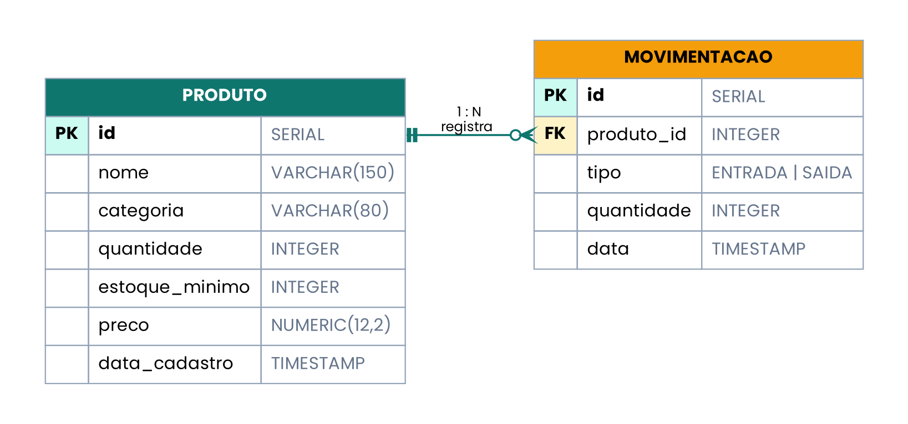

# Modelagem do Banco de Dados – SmartStock

**SGBD escolhido:** PostgreSQL 16 · **Script:** [`banco/smartstock_postgres.sql`](../banco/smartstock_postgres.sql)

## 1. Modelo conceitual

Duas entidades principais:

- **PRODUTO**: tudo o que a empresa guarda no estoque.
- **MOVIMENTAÇÃO**: cada evento que altera o saldo de um produto (entrada ou saída).

**Relacionamento:** um PRODUTO *registra* zero ou várias MOVIMENTAÇÕES; cada MOVIMENTAÇÃO pertence a um único PRODUTO → cardinalidade **1:N**.

## 2. Modelo lógico (DER)



## 3. Modelo físico

### `produto`

| Coluna | Tipo | Restrições | Significado |
|---|---|---|---|
| id | SERIAL | PK | Código do produto |
| nome | VARCHAR(150) | NOT NULL, UNIQUE | Descrição do produto |
| categoria | VARCHAR(80) | NOT NULL | Agrupamento (Filtros, Freios…) |
| quantidade | INTEGER | NOT NULL, ≥ 0 | Saldo atual (mantido pelo trigger) |
| estoque_minimo | INTEGER | NOT NULL, ≥ 0 | Ponto de reposição |
| preco | NUMERIC(12,2) | NOT NULL, ≥ 0 | Preço unitário |
| data_cadastro | TIMESTAMP | DEFAULT NOW() | Quando foi cadastrado |

### `movimentacao`

| Coluna | Tipo | Restrições | Significado |
|---|---|---|---|
| id | SERIAL | PK | Código da movimentação |
| produto_id | INTEGER | FK → produto.id, ON DELETE RESTRICT | Produto movimentado |
| tipo | ENUM `tipo_movimentacao` | 'ENTRADA' ou 'SAIDA' | Sentido da movimentação |
| quantidade | INTEGER | NOT NULL, > 0 | Unidades movimentadas |
| data | TIMESTAMP | DEFAULT NOW() | Momento do registro |

## 4. Decisões de projeto

| Decisão | Motivo |
|---|---|
| **Trigger `trg_atualiza_saldo`** | O saldo é recalculado pelo próprio banco a cada movimentação; a API nunca altera a quantidade diretamente (RN-02) |
| **CHECK `quantidade >= 0`** | Se uma saída deixasse o saldo negativo, o banco recusa a operação inteira (RN-01) |
| **`ON DELETE RESTRICT`** | Protege o histórico: produto com movimentações não pode ser apagado (RN-04) |
| **ENUM para `tipo`** | Garante que só existam os valores ENTRADA e SAIDA |
| **View `vw_situacao_estoque`** | Entrega pronta a situação (OK, BAIXO ou ZERADO) e o valor total por produto, consumida pelo painel, pelos relatórios e pelo N8N |
| **Índices** em categoria, data e produto_id | Agilizam filtros da tela de produtos e relatórios por período |

## 5. Consultas que o sistema vai usar

```sql
-- Itens que precisam de reposição (alerta / N8N)
SELECT nome, quantidade, estoque_minimo
  FROM vw_situacao_estoque
 WHERE situacao IN ('BAIXO','ZERADO')
 ORDER BY quantidade;

-- Valor total do estoque (dashboard)
SELECT SUM(valor_total) AS valor_estoque FROM vw_situacao_estoque;

-- Entradas x saídas por mês (gráfico)
SELECT date_trunc('month', data) AS mes, tipo, SUM(quantidade)
  FROM movimentacao GROUP BY 1, 2 ORDER BY 1;
```

## 6. Próximas tabelas (evolução)

`usuario` (login e perfis) · `fornecedor` · `alerta_enviado` (histórico das notificações do N8N).
