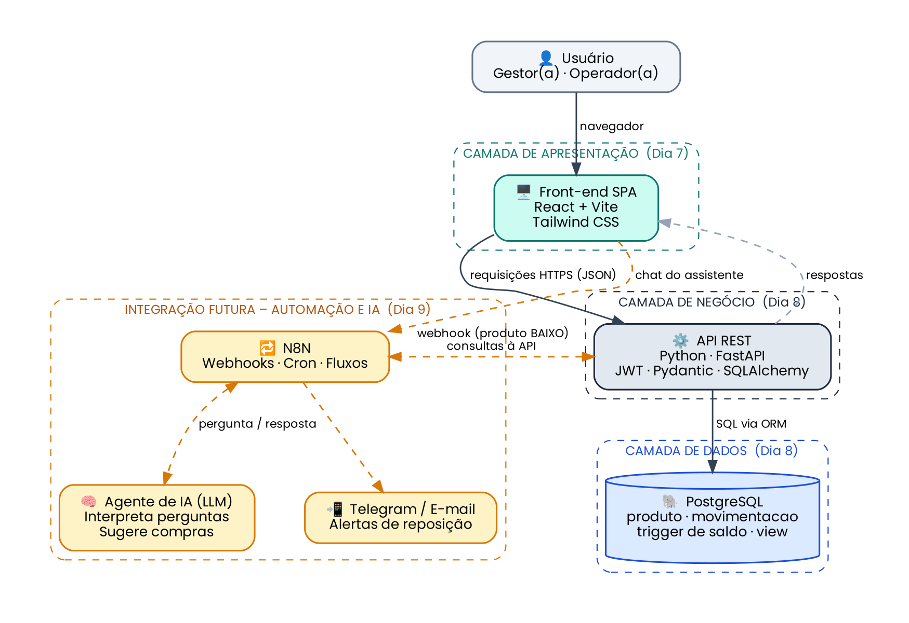
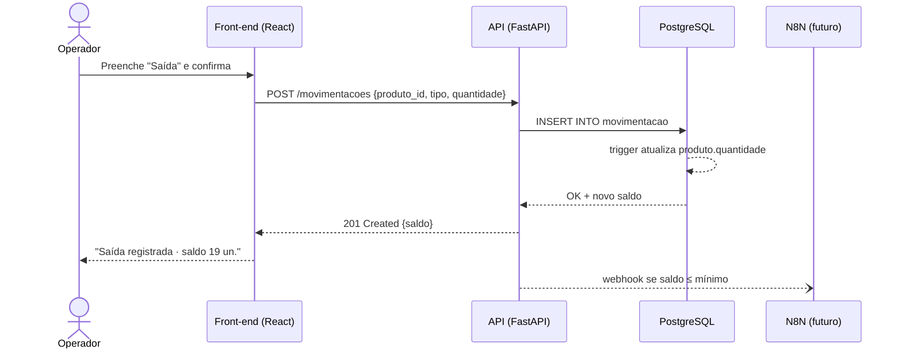

# Arquitetura da Solução – SmartStock

O SmartStock segue uma **arquitetura em três camadas**: apresentação, negócio e dados. Uma quarta camada, de **automação e IA**, será conectada no Dia 9. Todas as camadas conversam por meio de uma **API REST** que troca JSON.

## Fluxograma



**Legenda:** setas contínuas são o fluxo principal (Dias 7 e 8). Setas tracejadas em laranja são a integração futura com N8N e IA (Dia 9).

## Componentes

### 👤 Usuário
Gestores e operadores acessam pelo navegador, no computador ou no celular.

### 🖥️ Front-end (camada de apresentação)
- **React + Vite**, estilizado com **Tailwind CSS**
- Telas: Login, Painel, Produtos, Movimentações, Relatórios e Configurações
- Guarda o token JWT e chama a API com `fetch`/`axios`

### ⚙️ API (camada de negócio)
- **Python + FastAPI**: rápida, com documentação Swagger automática em `/docs`
- **Pydantic** valida os dados de entrada; **SQLAlchemy** faz o acesso ao banco
- Aplica as regras de negócio, a autenticação JWT e o controle de perfis
- Dispara **webhooks** para o N8N

### 🐘 Banco de dados (camada de dados)
- **PostgreSQL** com as tabelas `produto` e `movimentacao`
- Trigger que atualiza o saldo e view com a situação do estoque

### 🔁🧠 Automação e IA (Dia 9)
| Onde | O que acontece |
|---|---|
| **API → N8N** | Quando um produto entra em situação BAIXO, a API chama o webhook do N8N |
| **N8N → Telegram/E-mail** | O N8N envia o alerta de reposição para a compradora |
| **N8N → Agente de IA** | Perguntas do chat ("o que está acabando?") vão para um LLM junto com os dados da API |
| **N8N → API** | Fluxos agendados (Cron) consultam os relatórios e mandam um resumo diário |

## Sequência – registrar uma saída



## Rotas planejadas

| Recurso | GET | POST | PUT | DELETE |
|---|---|---|---|---|
| `/auth/token` | — | login | — | — |
| `/produtos` | lista e filtros | cria | — | — |
| `/produtos/{id}` | detalhe | — | edita | exclui |
| `/movimentacoes` | histórico | registra | — | — |
| `/painel/indicadores` | KPIs | — | — | — |
| `/relatorios/{tipo}` | inventário, movimentações, reposição | — | — | — |
| `/integracoes/n8n` | — | recebe callbacks | — | — |

## Organização prevista do código

```
smartstock/
├── web/          → React (Dia 7)
├── api/          → FastAPI (Dia 8)
│   └── app/  routers/ models/ schemas/ services/
├── banco/        → scripts SQL
├── n8n/          → fluxos exportados (Dia 9)
└── documentacao/
```
