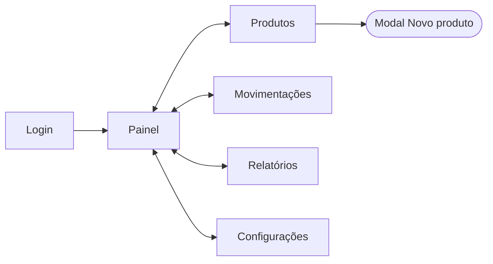
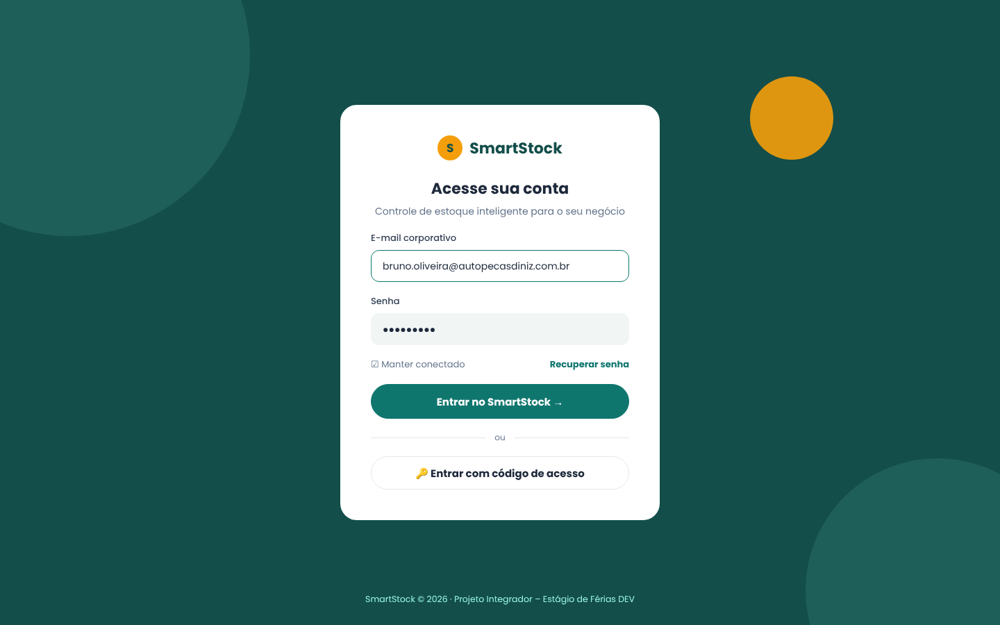
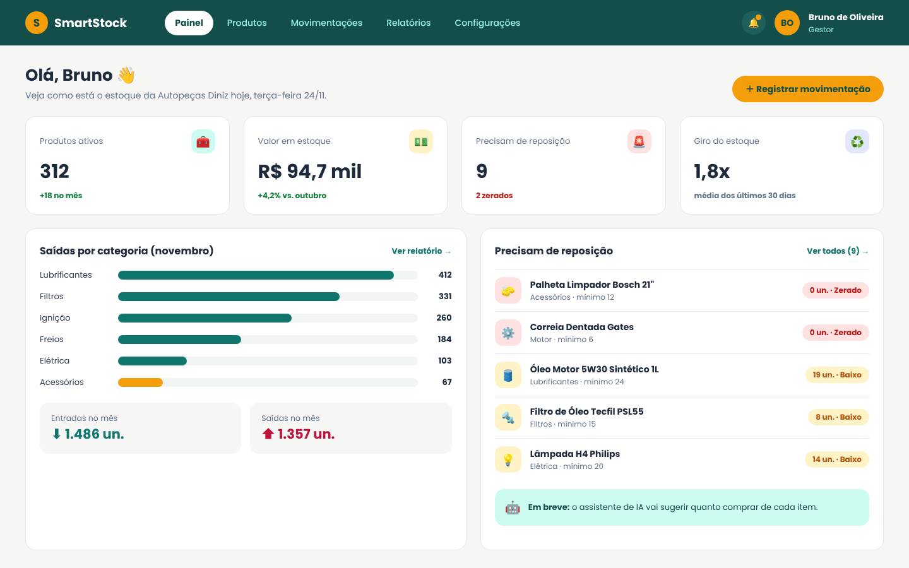
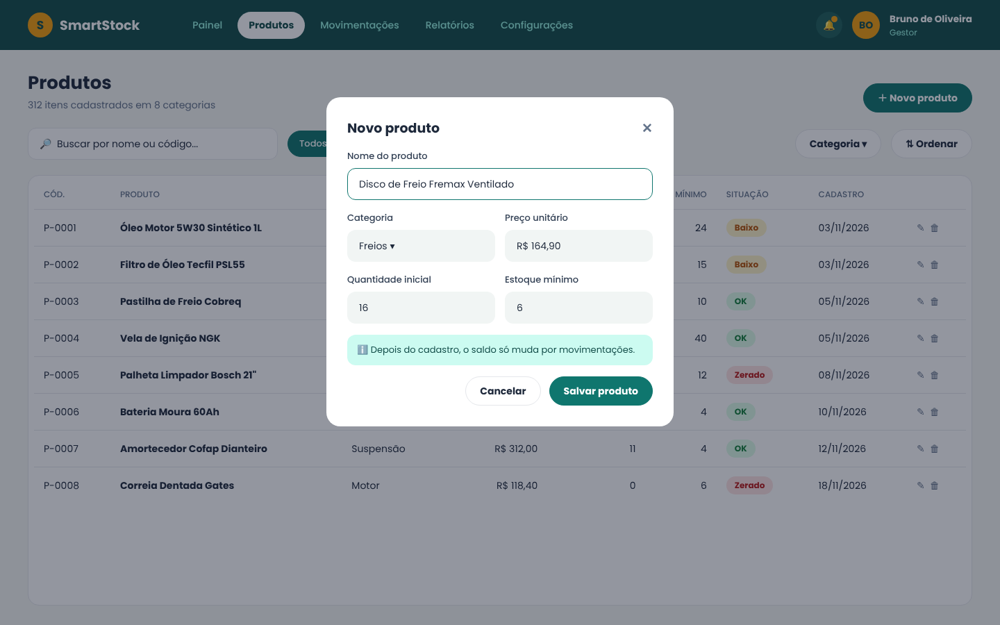
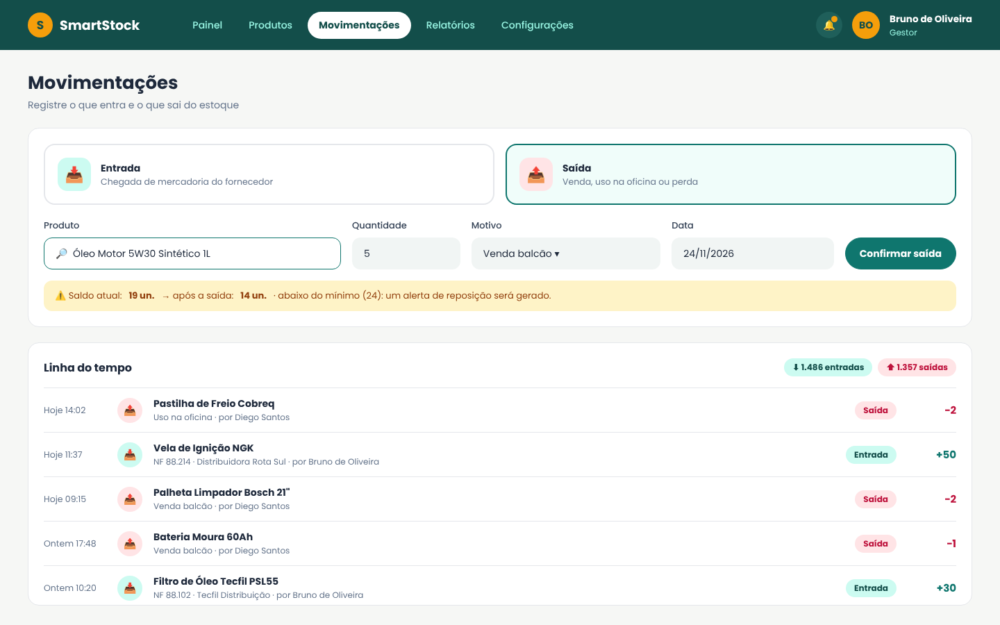
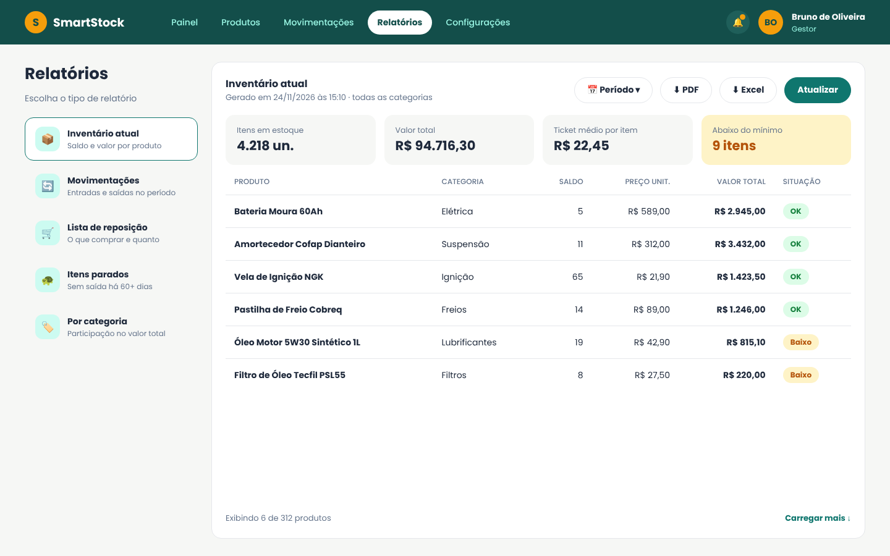
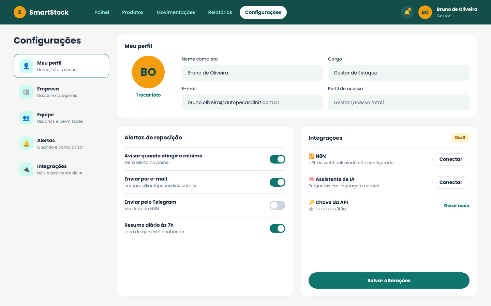

# Protótipo de Alta Fidelidade – SmartStock

🎨 **Link do Figma:** https://www.figma.com/design/2wjN6TUPeYMqab2NvezFPj

**Como navegar:** abra o link e aperte **Present** (▶). O fluxo começa no Login; o botão *Entrar no SmartStock* leva ao Painel, e o menu superior alterna entre as telas.

Versão em HTML: [`design/prototipo.html`](../design/prototipo.html)

## Mapa de navegação

## Telas

### 1. Login
Card centralizado sobre fundo verde-petróleo. Campo com foco destacado, opção "Manter conectado" e acesso alternativo por código.

### 2. Painel
Saudação personalizada, 4 indicadores (produtos, valor em estoque, itens para repor, giro), gráfico de saídas por categoria e lista dos itens que precisam de reposição.

### 3. Produtos
Busca, filtros rápidos por situação (OK, Baixo, Zerado), tabela com preço, saldo, mínimo e situação, e modal de cadastro de um novo produto.

### 4. Movimentações
Escolha visual entre Entrada e Saída, formulário em linha, aviso que simula o saldo depois da movimentação e linha do tempo com o histórico.

### 5. Relatórios
Menu lateral com 5 tipos de relatório; à direita, prévia com resumo, tabela e exportação em PDF e Excel.

### 6. Configurações
Perfil do usuário, preferências de alertas (painel, e-mail, Telegram, resumo diário) e área de integrações (N8N, IA, chave da API).

## Identidade visual

| Elemento | Definição |
|---|---|
| Cor primária | Verde-petróleo `#0F766E` / escuro `#134E4A` |
| Cor de destaque | Âmbar `#F59E0B` (ações rápidas, avatar, marca) |
| Estados | OK `#15803D` · Baixo `#B45309` · Zerado `#B91C1C` |
| Fundo | `#F6F7F5` (off-white) com cartões brancos |
| Tipografia | **Poppins** (400, 500, 600, 700) |
| Formas | Cantos arredondados de 12–24px; botões em formato de pílula |
| Navegação | Barra superior fixa com abas |
| Resolução base | 1440 × 900 (desktop) |

## Decisões de UX/UI

1. **Menu superior em abas:** libera largura para tabelas e mantém as 5 áreas sempre visíveis.
2. **Situação por cor + texto:** o status nunca depende só da cor (acessibilidade para daltônicos).
3. **Prévia de saldo antes de confirmar:** evita erros e já avisa quando a saída vai gerar alerta.
4. **Cadastro em modal:** o usuário não perde o contexto da lista.
5. **Filtros rápidos com contadores:** mostram de cara quantos itens estão Baixos ou Zerados.
6. **Linguagem simples:** "Precisam de reposição" em vez de jargões técnicos.
7. **Ação principal em destaque:** botão âmbar "Registrar movimentação" no Painel, que é a tarefa mais frequente.
8. **Espaços reservados para IA:** cards "Em breve" e área de integrações preparam a etapa do Dia 9.
